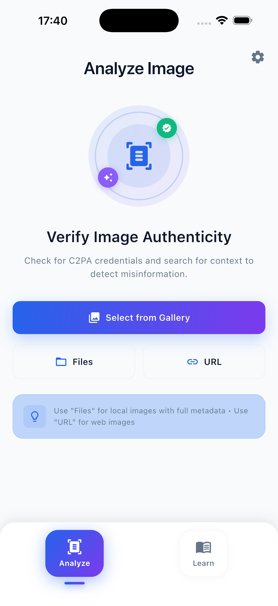
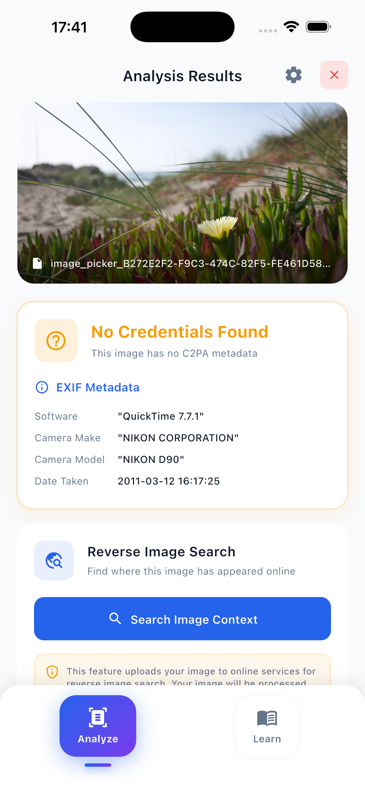
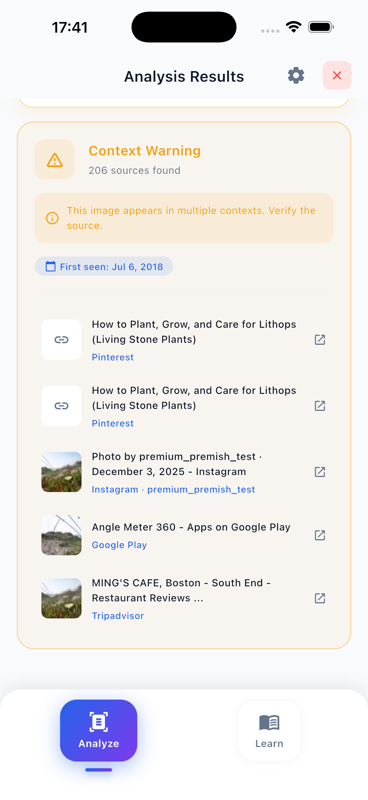
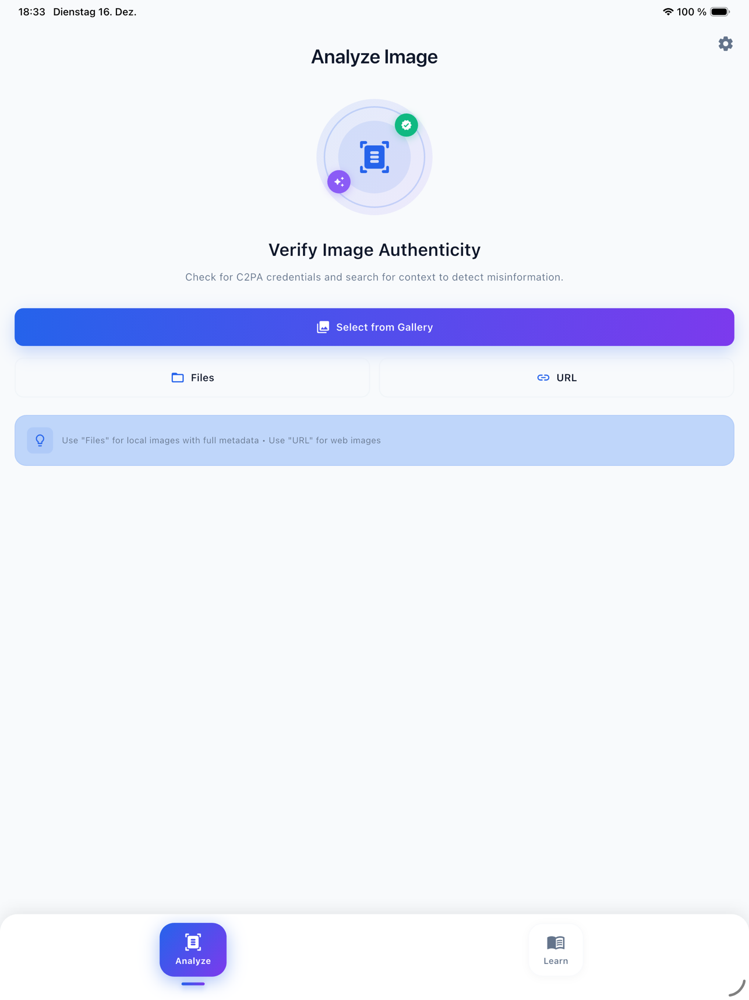
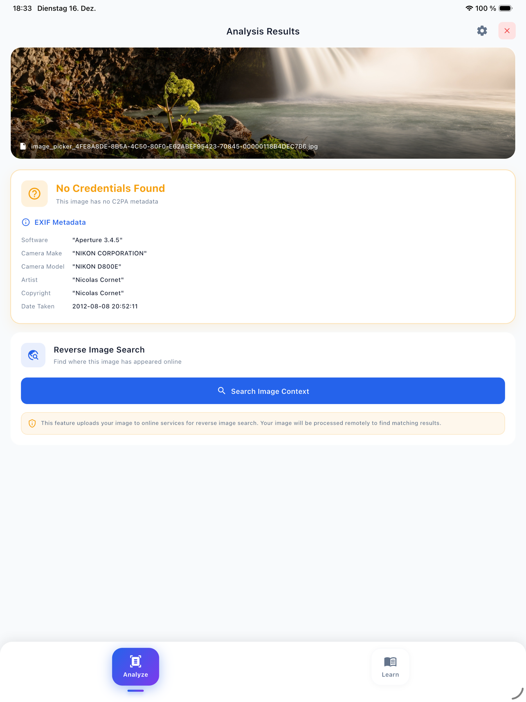

# Origin Lens – Verify Image Authenticity with C2PA Content Credentials

[](https://apps.apple.com/us/app/origin-lens/id6756628121)
[](https://apps.apple.com/us/app/origin-lens/id6756628121)
[](https://www.gnu.org/licenses/gpl-3.0)
[](https://doi.org/10.1145/3795513.3806658)
[](https://doi.org/10.5281/zenodo.22303807)

<p align="center">
  
</p>

**Combat fake news and misinformation by verifying the authenticity of images with cryptographic provenance data.**

Origin Lens analyzes images for C2PA (Coalition for Content Provenance and Authenticity) Content Credentials, EXIF metadata and SynthID to detect AI-generated content, verify digital signatures, and reveal the complete edit history of any image. Core verification happens on your device. An optional reverse image search feature uses external services to help detect out-of-context images.

---

## 📲 Download

Get Origin Lens on your iPhone or iPad to start verifying image authenticity today:

[](https://apps.apple.com/us/app/origin-lens/id6756628121?platform=iphone)

---

## Screenshots

| Pick an image | Read the verdict | Check the context |
|:---:|:---:|:---:|
|  |  |  |
| Analyze from the photo library, the Files app, or a pasted URL. | Verification state and EXIF metadata, here an image with no C2PA manifest and a Nikon camera signature. | Optional reverse image search: where else the image appears, and when it was first seen. |

These screenshots were taken before version 1.4.2 and do not show the color-coded verdict band yet; the result card now opens with one of the verdicts listed under [Color-coded verdicts](#color-coded-verdicts).

Origin Lens runs on iPad with the same verification path:

| | |
|:---:|:---:|
|  |  |

---

## Color-coded verdicts

Since version 1.4.2 on the App Store, every result opens with a colored band, so you see at a glance what an image's Content Credentials say. The color follows a fixed order: red over purple over green over yellow.

| Verdict | Color | Meaning |
|---|---|---|
| Content Credentials Valid | green | The signature is valid and the image is unchanged since signing. The signer is not checked against a trust list, and the result says so. |
| AI-Generated (Signed) | purple | Valid, signed credentials declare the image as AI-generated. |
| Credentials Invalid | red | The credentials fail validation, so do not rely on their claims. |
| Credentials Don't Match This Image | red | The image was changed after it was signed. |
| Certificate Expired | yellow | The signing certificate has expired, so the signature could not be checked. |
| Signer Not Verified | yellow | The signing certificate could not be validated. |
| No Content Credentials | yellow | Most images carry none, which alone is not a sign of manipulation. |
| Screenshot | yellow | A screenshot never carries the original's credentials, so look for the original file. |
| Credentials Held Elsewhere | yellow | The image points to credentials on another server that have not been fetched. |

Yellow means there is nothing Origin Lens can verify. It is not a verdict that an image is fake. AI tool names found only in unsigned metadata appear as a note and never decide the verdict.

---

## ✨ What Makes Origin Lens Different?

Origin Lens goes beyond simple metadata viewing. It performs cryptographic verification of Content Credentials, detects AI-generated content from multiple sources, and provides comprehensive provenance analysis. All verification happens locally on your device.

### C2PA Content Credentials Verification

Cryptographically verify the authenticity of images.

- **Digital signature validation** – Verify cryptographic signatures on embedded C2PA manifests
- **Certificate checks** – See whether the signing certificate has expired; signers are not checked against a trust list
- **Tamper detection** – Identify if content has been modified since signing
- **Signer information** – View organization, issuer, and timestamp details
- **Clear verdicts** – Content Credentials Valid, AI-Generated (Signed), Credentials Invalid, Credentials Don't Match This Image, Certificate Expired, Signer Not Verified, No Content Credentials, or Screenshot

### 🤖 AI Generation Detection

Identify AI-generated content from multiple sources.

- **C2PA assertions analysis** – Detect AI generators from standard Content Credentials
- **EXIF metadata parsing** – Find AI signatures in image metadata
- **Multi-source detection** – Combines C2PA, EXIF, and SynthID for comprehensive coverage
- **Experimental AI opinion** – For images without Content Credentials, you can ask Google Gemini for an opinion, shown as "AI Opinion (Gemini, experimental)" in neutral colors. It is an assessment, not a cryptographic proof, and it sends the image only after you confirm
- **50+ AI generators detected** – Midjourney, DALL-E, Stable Diffusion, Adobe Firefly, and more
- **Detection source transparency** – Shows whether AI was detected via C2PA, EXIF, or SynthID

### 📜 Complete Edit History Timeline

See every action performed on an image.

- **Action-by-action timeline** – View capture, edit, and publish events
- **Software agent tracking** – Identify tools used to create and modify content
- **Timestamp information** – When each action occurred
- **Digital source type** – Understand the origin (camera capture, screen capture, AI generation, etc.)

### EXIF Metadata Analysis

Access detailed image metadata. EXIF details are shown for every image that carries them, with or without Content Credentials, including images opened from a web address.

- **Camera information** – Make, model, and settings
- **Software details** – Applications used to create or edit the image
- **Artist and copyright** – Creator attribution
- **Date and time** – When the photo was taken
- **AI detection markers** – Prompt parameters, generation settings, and AI tool signatures

### 🔎 Reverse Image Search (Optional)

Find where images have appeared online.

- **Named services** – The prompt names every service your image is sent to: with the built-in keys, the image is stored for five minutes on imgbb and its address is sent to SerpAPI, which searches Google; without them, it goes directly to Google, Bing and Yandex
- **Context verification** – Detect out-of-context or misattributed images
- **Smart filtering** – Removes irrelevant results like login pages
- **Privacy notice** – You confirm before anything is uploaded
- **Bring your own keys** – Use your own API keys for enhanced privacy

> **Note:** This optional feature uploads images to external search services. A clear privacy note is shown before use.

### 📤 Multiple Input Sources

Analyze images from anywhere.

- **Photo Library** – Select from your gallery
- **Files App** – Access iCloud Drive and local files
- **URL Analysis** – Paste image URLs for remote verification

---

## 📱 Key Features

### 🔍 Image Analysis
Select images from your photo library, files, or paste a URL to analyze any image for Content Credentials and metadata.

### ✅ Verification Status
A color-coded verdict opens every result: green for valid Content Credentials, purple for signed AI generation, red for credentials that fail or no longer match the image, and yellow when there is nothing to verify. See [Color-coded verdicts](#color-coded-verdicts).

### 🤖 AI Detection Badge
Prominently displays when content is detected as AI-generated, showing the generator name and detection method.

### 📊 Detailed Provenance Information
View signer details, complete edit history, EXIF metadata, and raw manifest data all in one comprehensive interface.

### 🌐 URL Support
Analyze images directly from the web without downloading them first.

---

## 🔒 Privacy You Can Trust

**Core verification happens on your device. Optional features use external services with clear disclosure.**

- ✅ **On-device verification** – All C2PA and EXIF analysis runs locally
- ✅ **Zero data collection** – No analytics, no tracking, no servers
- ✅ **No account required** – Works immediately after install
- ✅ **Transparent remote features** – Reverse image search clearly warns before uploading
- ✅ **Bring your own API keys** – Use personal keys for external services
- ✅ **Privacy first** – Read our [Privacy Policy](https://github.com/aloth/origin-lens/blob/main/privacy_policy.md)

---

## FAQ

**What is Origin Lens?**
Origin Lens helps you check where a digital image comes from. On your device, it reads C2PA Content Credentials, verifies their signature, and checks whether the image was changed after signing. An optional reverse image search shows where else the image has appeared online, as context for your own judgment.

**What is C2PA?**
C2PA (Coalition for Content Provenance and Authenticity) is an open technical standard that allows publishers to embed tamper-evident information about who created a piece of content and how it was altered. Origin Lens reads this data and shows what the credentials record about how the image was made and edited.

**What does a yellow verdict mean?**
That there is nothing Origin Lens can verify: the image has no Content Credentials, is a screenshot, points to credentials elsewhere, or its certificate is expired or could not be validated. Most images carry no credentials at all, so yellow alone is not a sign of manipulation.

**Why might an AI image not be detected?**
Most AI tools do not embed C2PA metadata yet. Taking a screenshot instead of downloading removes all metadata, social media platforms strip C2PA on upload, and many image editors remove it.

**How do I test C2PA detection?**
Download an image from the [public C2PA test files](https://github.com/c2pa-org/public-testfiles), save it to the Files app (not Photos), and open it in Origin Lens with "Select from Files". The result shows what the file's Content Credentials record. Some test files are deliberately broken, so a red result can be correct.

**What leaves my device?**
Nothing during verification: C2PA and EXIF analysis run on your device. Three optional features use the network, and each asks first. The AI opinion sends the image to the Google Gemini API. Reverse image search sends the image, or its web address, to the services named in the prompt (imgbb and SerpAPI, or Google, Bing and Yandex directly). Fetching credentials held elsewhere contacts the host the image names, but does not send your image. Details are in the [Privacy Policy](privacy_policy.md).

---

## Open Source

Origin Lens is open source software, licensed under the [GNU General Public License v3.0](LICENSE).

**Want to contribute or build from source?** See the [Build Instructions](src/README.md) for development setup, architecture details, and contribution guidelines.

---

## Support & Feedback

Help make Origin Lens better:

- 🐛 [Report a Bug](https://github.com/aloth/origin-lens/issues/new?template=bug-report.md)
- 💡 [Request a Feature](https://github.com/aloth/origin-lens/issues/new?template=feature_request.md)
- 📧 [Contact Support](mailto:support@alexloth.com)

---

## Related Research

Origin Lens is part of a broader research initiative investigating the intersection of generative AI and misinformation. We invite researchers, practitioners, and policymakers to explore our related work and contribute to advancing this critical field.

### Publications

Two papers describe this work:

- **WebSci '26** — *Origin Lens: Reclaiming Trust on the AI-Mediated Web Through On-Device Image Provenance Verification.* 18th ACM Web Science Conference, Braunschweig. [doi:10.1145/3795513.3806658](https://doi.org/10.1145/3795513.3806658)
- **Preprint** — *Origin Lens: A Privacy-First Mobile Framework for Cryptographic Image Provenance and AI Detection.* [arXiv:2602.03423](https://arxiv.org/abs/2602.03423). Accepted at the FIIR workshop of The Web Conference 2026; that workshop was subsequently cancelled, so this one exists as a preprint only.

The first is the one to cite.

### How to Cite

If you use Origin Lens or its underlying research in your work, please cite our paper. In the app, "Cite Origin Lens" in the Learn tab copies references to both papers.

> **Origin Lens: Reclaiming Trust on the AI-Mediated Web Through On-Device Image Provenance Verification**  
> Alexander Loth, Dominique Conceicao Rosario, Peter Ebinger, Martin Kappes, Marc-Oliver Pahl  
> 18th ACM Web Science Conference (WebSci Companion '26), Braunschweig, Germany  
> [doi:10.1145/3795513.3806658](https://doi.org/10.1145/3795513.3806658)

```bibtex
@inproceedings{loth2026originlenswebsci,
    author    = {Loth, Alexander and Rosario, Dominique Conceicao and
                 Ebinger, Peter and Kappes, Martin and Pahl, Marc-Oliver},
    title     = {Origin Lens: Reclaiming Trust on the {AI}-Mediated Web
                 Through On-Device Image Provenance Verification},
    booktitle = {18th ACM Web Science Conference (WebSci Companion '26), May 26--29, 2026, Braunschweig, Germany
                 (WebSci '26)},
    year      = {2026},
    month     = may,
    publisher = {ACM},
    address   = {New York, NY, USA},
    pages     = {1--5},
    doi       = {10.1145/3795513.3806658},
    venue     = {Braunschweig, Germany},
    eventdate = {2026-05-26/2026-05-29}
}

@misc{loth2026originlens,
    author        = {Loth, Alexander and Rosario, Dominique Conceicao and
                     Ebinger, Peter and Kappes, Martin and Pahl, Marc-Oliver},
    title         = {Origin Lens: {A} Privacy-First Mobile Framework for
                     Cryptographic Image Provenance and {AI} Detection},
    year          = {2026},
    eprint        = {2602.03423},
    archivePrefix = {arXiv},
    primaryClass  = {cs.CR},
    note          = {Accepted at the FIIR workshop, The Web Conference 2026;
                     the workshop was subsequently cancelled}
}
```

### Related Projects

Origin Lens is one strand of a wider research program on generated disinformation:

| Project | Description |
|:---|:---|
| [JudgeGPT](https://github.com/aloth/JudgeGPT) | Empirical platform for evaluating AI-generated news authenticity |
| [RogueGPT](https://github.com/aloth/RogueGPT) | Controlled stimulus generator for AI news authenticity research |
| [CRED-1](https://github.com/aloth/cred-1) | Open multi-signal domain credibility dataset (2,673 domains) |
| [verification-crisis](https://github.com/aloth/verification-crisis) | Expert survey on GenAI disinformation threats and countermeasures |
| [provenance-linkage](https://github.com/aloth/provenance-linkage) | Reproducibility bundle for a benchmark audit of AI-text detection |

### Related Publication

Our survey on the dual nature of generative AI in the context of fake news:

> **Blessing or Curse? A Survey on the Impact of Generative AI on Fake News**  
> Alexander Loth, Martin Kappes, Marc-Oliver Pahl (2024)  
> arXiv:2404.03021 [cs.CL]

```bibtex
@misc{loth2024blessing,
  author        = {Loth, Alexander and Kappes, Martin and Pahl, Marc-Oliver},
  title         = {Blessing or Curse? {A} Survey on the Impact of Generative {AI} on Fake News},
  year          = {2024},
  doi           = {10.48550/arXiv.2404.03021},
  eprint        = {2404.03021},
  archivePrefix = {arXiv},
  primaryClass  = {cs.CL}
}
```

### Call for Participation

We are conducting an expert survey to gather insights on generative-AI–driven disinformation. Your expertise would be invaluable to this academic research effort.

**[Participate in the Expert Survey](https://forms.gle/EUdbkEtZpEuPbVVz5)**

This survey explores expert perceptions of generative-AI–driven disinformation and aims to inform future countermeasures and policy recommendations.

---

## Learn More

- [C2PA Coalition](https://c2pa.org/) – Learn about Content Credentials technology
- [Content Authenticity Initiative](https://contentauthenticity.org/) – Adobe's initiative for content provenance
- [Verify Tool](https://contentcredentials.org/verify) – Official C2PA verification tool

---

## Keywords

C2PA verification, Content Credentials, image authenticity, AI detection, EXIF metadata, digital provenance, fake news detection, misinformation prevention, cryptographic verification, AI-generated content, image forensics, media verification, trust and safety, content authenticity, iOS privacy app

---

**Verify image authenticity. Combat misinformation.**
